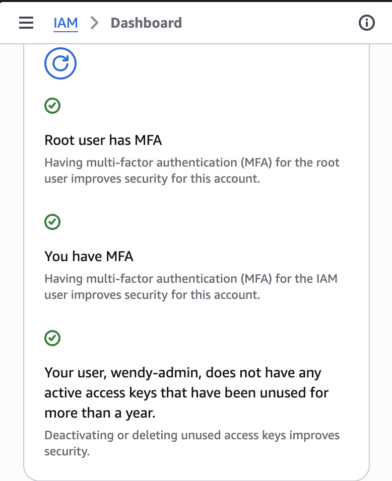
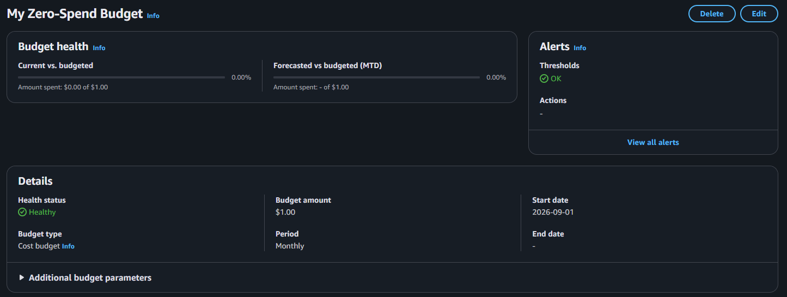

# Week 1 — Cloud Fundamentals & Account Setup

## What I Learned

1. The AWS Root User is the original account identity and has full access to all AWS services and resources.
2. For security reasons, the Root User should only be used for tasks that require root-level access.
3. I enabled Multi-Factor Authentication (MFA) to add an extra layer of security to my AWS account.
4. I created an IAM user named `wendy-admin` with the `AdministratorAccess` policy for the training labs.
5. IAM allows administrators to manage users and permissions, following the principle of least privilege whenever possible.
6. Under the AWS Shared Responsibility Model, AWS is responsible for security *of* the cloud, including its physical infrastructure.
7. Customers are responsible for security *in* the cloud, including IAM permissions, data protection, and appropriate resource configurations.

## Hands-on Labs Completed

- Lab 1.1: Enabled MFA for the Root User.
- Lab 1.2: Created a Zero Spend Budget to monitor AWS costs.
- Lab 1.3: Created an IAM administrator user.
- Lab 1.4: Configured AWS CLI and verified my IAM identity.
- Debug Lab 1.5: Checked AWS environment variables and verified CLI credentials.

## Evidence

### Root MFA Enabled

### Zero Spend Budget

